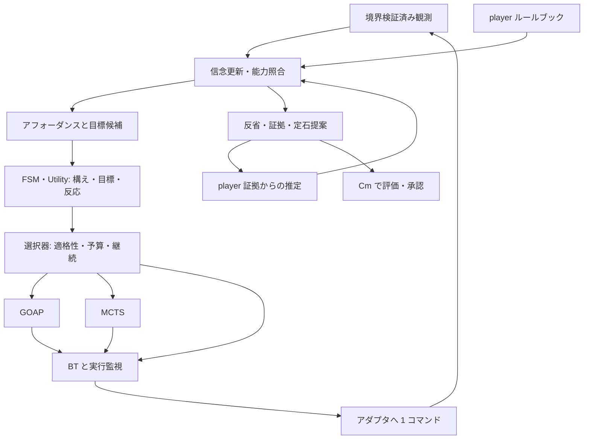

# 独立オートプレイヤー設計（Astra 案）

2026-10-11。Actio: `actio:cbcc7924-9641-4e62-ac3f-a73166aa4fd3`。
依頼の正本: [設計委託](../tasks/2026-10-11-autoplayer-paradigms-design-request.md)。
参照 checkout: `aff49e42cf182095c5dbf075993a17e21c94fb9d`。
本書は [全体設計](../architecture/design.md) §16 の確定前の独立案。Fable 案は参照していない。実装・契約ファイル変更・テスト実行・PR 提出は行わない。

## 1. 結論

独立プロジェクト **Auriga（御者、仮称）** を推奨する。Commentarii（Cm）は知識の製作・境界審査・プレイ証跡の評価、Auriga は許された知識による判断・行動・証跡生成を担う。Cm が未起動・未インストールでも、適合するルールブックとアダプタだけで動く。

判断系は、役割別の方式群と計算配分器にする。FSM は持続する構え、Utility は目標・反応行動、GOAP は前提を作る手順探索、MCTS は相手・確率を含む先読み、BT は反応・実行監視を担当する。外部の Decider は統一するが、内部は Policy / Planner / Executor に分ける。5 方式の単独利用と組合せを実装し、毎 tick 全方式を競わせる構成にはしない。

ルールは型・単位・時間・空間・確率・観測可能性を持つデータとする。ゲームの実状態とプレイヤーの信念を分け、前向きモデルを「プレイヤーが持てる証拠に基づく予測器」とする。モデル不足を秘密データで補わず、反応・観測・実験へ戻れる構成にする。

autonomous は定石・意図・定石由来の重みを読み込めない入力型にする。公開勝敗条件と利用者目的を目標に、能力の前提・効果から手段を合成する。成功手順は Cm へ定石候補として返し、自律モードがそれを次回密かに読み戻すことはしない。

フルセットを R0（分離・互換）→ R1（ルールと予測）→ R2（5 方式）→ R3（方式選択・実験・学習・統合）で完成させる。機能を恒久的に削る MVP にはしない。先に固めるのは知識の非干渉、操作と完了の違い、時間意味論、再現可能な予算、契約の所有者である。

## 2. 解釈

### 2.1 「判断系アルゴリズムを理解している」

アルゴリズムを文章で説明する LLM を判断ループに置く意味にはしない。方式ごとに実装、適用条件、必要なモデル能力、計算費用、打切り結果、説明用証跡を持ち、その条件を実行前に検査できることとする。

| 方式 | 主な役割 | 必要条件 | 限界の扱い |
|---|---|---|---|
| FSM | 状態保持・切替、単独の小方策 | 条件・遷移優先順・状態別方策 | 全ゲームに交戦/回収を強制しない。未定義遷移は維持 |
| BT | 優先反応、条件付き手順、再開・取消 | ガード、葉の実行契約、明示メモリ | 木だけから新しい長期計画は発明しない |
| Utility | 目標と即時行動の選択 | 有限候補、正規化評価、リスク制約 | 準備行動の将来価値は計画器から受ける |
| GOAP | 前提を作る行動列の合成 | 有限抽象、前提/効果、非負費用、目標述語 | 不明効果を確定扱いしない。予算切れと到達不能を分ける |
| MCTS | 確率・相手応答込みの価値推定 | 安価で校正された生成モデル、評価、合法行動 | 大分岐だけを理由に選ばない。モデル誤差/短い予算では反応へ |

「MCT」は文脈に従い MCTS と読む。別の略語を必要とする根拠は今回の資料にはない。

### 2.2 自律性と与える目的

「攻略法に依存しない」は、仕様を知らないことでも目的を無から作ることでもない。

- メカニクス: 何をすると何が起きるか。資源・射程・時間・勝敗条件。自律判断の入力。
- 能力: actor が今持つコマンド・装備・操作可能性。ルールにある行動と本人が持つ能力は別。
- 目的: 公開終端条件と、利用者指定の達成・生存・効率・coverage。
- 攻略法: 推奨手順、教えたい技、正解経路。自律判断に入れない。

勝利条件さえ未認識なら、明示した生存・情報取得等の暫定目的で動く。隠しマスターや intent で補完せず「クリアを保証できない」と記録する。

mode=player/omniscient、stance=autonomous/guided/hybrid、purpose=efficiency/coverage、decision_mode=player-knowledge/intent-assisted は独立軸。autonomous と intent-assisted は併用不可。全知・意図支援の記録はプレイヤー能力推定と知識昇格の根拠から外す。

## 3. 比較した案とトレードオフ

| 案 | 利点 | 欠点 | 採否 |
|---|---|---|---|
| 固定 FSM → Utility → GOAP/MCTS → BT | 追跡しやすく既存資産を使える | 全局面で全層を通す。FSM に正解を埋め込みやすい | 責務は採るが固定通過は採らない |
| 5 方式を毎回並列に競わせる | 比較データを得やすい | 計算浪費。異なる費用や目的の素点は比較不能。実行メモリも競合 | オフライン比較用 |
| 全部 MCTS + 単一 sim | 構成を減らせる | 誤モデル、連続空間、短期限で不利。5 方式要件を満たさない | 不採用 |
| 役割別部品 + 適格性判定 + 有界計算配分 | 反応を保ち必要な局面だけ探索 | 複数の内部契約と予算管理が必要 | **推奨** |

方式が多ければ強いとは仮定しない。単方式、組合せ、選択器なしの対照を用意し寄与を測る。

## 4. 推奨案の詳細

### 4.1 判断の流れと契約



1 回の順序は、観測検証 → 前回結果の照合 → 信念/能力更新 → 即時反応 → 目標/方式選択 → 有界計算 → 実行ガード → 送信 → 証跡保存。送信前の観測を効果の証拠にせず、次観測以降の相関 ID と時間窓で結果を結ぶ。

外部の `Decider.decide(observation) -> {decision, action}` は互換 façade として維持する。以下は新しい内部契約案で、今回コードは追加しない。

| 契約 | 入出力・責務 |
|---|---|
| DecisionContext | actor、許可された knowledge view、知覚時刻、belief、goal、論理予算、乱数。full bundle/intent は渡さない |
| Policy.step(context, memory) | FSM/BT/Utility が行動提案または計画要求と次メモリを返す |
| Planner.advance(problem, cursor, budget) | GOAP/MCTS が計画提案・進捗・次 cursor。solved/partial/budget-exhausted/unsupported/proven-unreachable を区別 |
| PredictionModel.step(state, jointActions, horizon, randomKey) | 次状態・経過時間・イベント・観測の分布または標本。モデル版を固定 |
| Executor.step(plan, observation, receipts) | 前提/継続条件/完了を検査して 1 コマンドか待機。取消・拒否・完了を区別 |
| OpponentPolicy.predict(view, memory, budget) | 相手視点での行動分布。相手から見えない私有情報にアクセス不可 |

提案は actor、goal、first_action、assumptions、dependencies、validity、predicted_outcomes、consumed_work、reason を持つ。GOAP の費用と MCTS の Q 値を直接比較せず、達成確率・時間・資源・被害・情報価値を共通評価器で比較する。未知の指標は未知のまま。利用者の硬い制約を通過した候補から効用で選ぶ。

### 4.2 方式選択規則と学習

入力は可視の行動数・連続 parameter、目標述語、モデル能力と校正誤差、公開情報からの相手モデル、危険の切迫、現計画の有効性、論理予算、persona。敵の存在だけで方式を決めない。

| 優先 | 条件 | 実行 |
|---|---|---|
| 1 | 可視の危険、拒否、計画ガード破綻 | 取消可能性を確認し BT 反応枝/Utility 即時候補。探索完了を待たない |
| 2 | 次操作が有効で、改善期待が切替費用以下 | 現計画を継続。FSM 最小滞在時間は緊急時解除 |
| 3 | 予測誤差過大、演算未対応、不明値で不適格 | FSM/BT/Utility。低リスクの観測・実験も候補 |
| 4 | 有限抽象、多段前提、十分確定した効果、相手応答を条件化可能 | GOAP。敵ありでも可 |
| 5 | 校正済み生成モデル、分岐の有界化、必要探索量を確保可能 | MCTS。敵なし確率問題も可 |
| 6 | 計画器が不適格、または有効提案なし | 反応方策。最後はアダプタが宣言する中立入力か停止 |

4 と 5 が適格なら、版固定の費用/品質表と局面実績で計算を配分する。両方を動かしても合計予算は増やさず、既定の主計画器は 1 つ。FSM/BT は standalone 方策としても選べる。

実績補正は局面署名ごとの contextual bandit とする。適格性・境界・リスク制約を通過した方式だけが腕になる。署名は公開特徴の bin、目的、モデル版、能力集合、予算 class。報酬は目標 episode の終わりに達成・損失・計算費用から作り、選択時点と結ぶ。同じ成功を毎 tick 重複加算しない。未選択方式の結果を捏造しない。

固定規則の対照データ → オフライン補正 → 制約付きオンライン探索の順に導入する。調整用と評価用 seed を分け、モデル変更・校正悪化では統計を版別に分離する。run 間更新を既定とし、run 内更新を使う場合は更新列もリプレイする。

### 4.3 ルールのデータ表現

Cm は小さい JSON の authoring 文書を持つ。Auriga の契約 package が実行意味論・型付き IR・compiler の版を所有し、Cm は compiler/validator で公開実行 package を作る。Guide Bundle と実行ルール形式は別の版にする。

| 文書 | 内容 |
|---|---|
| variables | owner、型/単位、公開値域、観測 binding、knowledge/source |
| actions | 能力対応、parameter、開始/継続条件、開始/終了/取消効果、費用、入力対応 |
| processes/events | 移動・回復・飛翔・外生イベント・同時刻順序 |
| space | 座標、障害物、衝突、経路グラフと連続位置の関係 |
| behaviors | 相手の公開/観測モデル。5 方式を明示 |
| objectives | 公開勝敗述語。推奨手順や意図ルートは含めない |
| observation-model | 可視状態から観測への変換、欠測、丸め、遅延 |

人間向け式は文字列、実行時は型検査済み AST と symbol table。マスター取込みは mapping と出典を保ち、LLM が数値・境界・ID を決めない。

以下は**提案形式の例**。現行 schema に通る fixture ではなく、数値・出典は仮値で Bestia の実測ではない。fact は内部の値・式・集合へ knowledge/source を付ける包み。子のラベルとの合成は厳しい方を採る。外側は schema が許可した形式版・ローカル ID のみ。型・値域もゲーム情報として境界を持つ。

```json
{
  "format": "rulebook-authoring/2",
  "id": "action:example:dash-strike",
  "fact": {
    "knowledge": "shown",
    "source": { "kind": "human", "ref": "example:public-ability-spec" },
    "value": {
      "actor": "self",
      "requires_capability": "skill:example:dash-strike",
      "params": { "target": { "type": "entity", "domain": "visible.hostile" } },
      "maps_to": { "use_skill": "skill:example:dash-strike", "target": "$target" },
      "pre": "ready(self, 'skill:example:dash-strike') && distance(self, $target) <= 6m && stamina(self) >= 20stamina",
      "start": {
        "consume": { "stamina(self)": "20stamina" },
        "cooldown": { "ability": "skill:example:dash-strike", "duration": "4s", "starts": "on_start" }
      },
      "temporal": {
        "duration": "0.6s",
        "interruptible": true,
        "invariant": "alive(self)",
        "cancel": { "refund": "none", "cooldown": "keep" }
      },
      "during": { "primitive": "move-toward/1", "actor": "self", "target": "$target", "stop_distance": "1m" },
      "finish": { "emit": "event:example:strike-attempt" },
      "completion": "receipt.finished(command_id)"
    }
  }
}
```

発動できることと命中/damage を分ける。効果未知でも公開された操作は失われない。資源消費と score 用費用を混同して二重消費しない。速度等の参照 symbol は package 内で宣言し、未解決なら compiler が拒否する。

確率は outcomes 内の相互排他的な枝に与え、枝の effects は同時に起きる。独立抽選は別 choice_id。次も公開抽選の仮例。

```json
{
  "id": "event:example:coin-strike",
  "fact": {
    "knowledge": "shown",
    "source": { "kind": "human", "ref": "example:public-chance-spec" },
    "value": {
      "choice_id": "coin-strike-result",
      "outcomes": [
        { "probability": { "numerator": 3, "denominator": 4 }, "effects": [{ "add": { "hp($target)": "-10hp" } }] },
        { "probability": { "numerator": 1, "denominator": 4 }, "effects": [] }
      ]
    }
  }
}
```

不明確率を除いて残りを正規化しない。未知残余を表せるのは残余の存在も公開されている場合だけ。それ以外は public 側で独立に宣言した「効果未モデル化」を使う。期待状態で勝敗判定しない。HP が 0 または 20 の分布は HP=10 と等価ではない。期待値は評価集計だけ、遷移/合法性は枝・標本・区間で扱う。

### 4.4 式言語の拡張範囲

現行 evaluateExpression は有限数を返し、ゼロ除算・未知変数をエラーにする。この expr/1 契約を保持し、新しい expr/2 を明示指定する。R1 案の「真偽値は 1/0」は新形式の基本型には採らない。

expr/2 は number<unit>、bool、entity/id/enum、vector、有限集合、比較、論理、短絡 if、束縛済み parameter、登録済み純粋関数を持つ。暗黙の数値/真偽変換を禁止。ID は引用する。all/any/count は宣言済み有限集合と上限内だけ。任意 JS、I/O、実時刻参照、再帰、無制限ループは認めない。

未知は Unknown<T>。false && unknown=false、true || unknown=true、未確定比較は unknown。未選択 if 枝は評価しない。条件未知で両枝が同値でなければ未知または枝集合を返す。構文誤り・単位不一致・ゼロ除算はモデルエラーで、未知に混ぜない。範囲外を暗黙 clamp しない。

長さ・深さ・集合数・instruction 数を制限し予算へ課金する。旧式の深さ上限 64 は維持。distance/line_of_sight/path_distance/move-toward/collision は版付き汎用 primitive。複雑なゲーム物理の完全再現を約束せず、近似誤差と対応範囲を宣言する。拡張 primitive は版・単位・決定性・境界・費用上限を登録し、未対応なら拒否。秘密のゲーム実装を呼ぶ万能 plugin を player の予測器に渡さない。

### 4.5 時間・空間・同時性

時刻は整数 game quantum、秒への比は有理数。進行中 action、cooldown 終了時刻、イベント queue、actor ごとの占有 channel を状態に持つ。実時計は性能計測用。

リアルタイムは同じ開始 snapshot から各 actor の入力を集め、公開優先度で開始可否を決め、移動・衝突・飛翔・持続効果を進める。同時刻イベントは (time, phase, priority, stable-id) 順。右辺は同一 snapshot で評価し、同変数への競合は sum/max/priority 等の宣言がなければ拒否。開始・命中・終了・cooldown のどの時点で費用が生じるかを分ける。

ターン制は手番・phase・優先権を持つ同じイベント核を使う。全 actor が交互に 1 回ずつ動くとは仮定しない。カードの割込み、pass、ドロー、隠しデッキ順も公開ルールと観測範囲で表す。

連続位置は意味を保ち、計画器が navgraph、目的地、方向、継続時間を有限候補へ抽象化する。候補は可視地形・射程境界・公開目標から作り、量子化幅と上限を記録。MCTS は訪問数に応じた有界 widening を使う。抽象上の未到達を実空間の不可能としない。Bestia 型では歩行/射撃の占有 channel、弾速、回避猶予を表せることを必須とする。

現行 stepSim は自分 → 敵配列順 → 回復 → 時刻という逐次更新。抽出時は legacy-sim/1 として維持する。新しい同時イベントモデルは別版とし、旧 sim の順序を密かに変えて回帰基準を壊さない。

### 4.6 アフォーダンスと計画生成

単一分類では足りないため、開始可能性、効果予測、到達証拠を分ける。

| 軸 | 値 |
|---|---|
| 開始可能性 | enabled（可視条件で成立）、blocked（不成立の根拠）、unknown（合法性未確定） |
| 効果 | modeled、estimated、unmodeled |
| 到達証拠 | now、witness(plan/horizon/assumptions)、not-found(budget)、proven-unreachable(proof-scope) |

「今できる」「数手でできる」「試さないと分からない」はこの射影で、排他的でなくてよい。enabled + unmodeled は今試せる未知能力。存在自体が masked の行動は一覧にも実験候補にも出ない。

requires_capability を観測・公開装備情報に結び、能力保有、入力可否、目標到達を別判定する。custom は SDK が宣言した語彙・parameter だけを使い、隠しコマンド文字列を総当たりしない。

数手先は backward relevance と forward 検証を組み合わせる。1〜2 手は予算 profile の一つで、可能性の定義ではない。GOAP は有限抽象で A* を行い、下界を証明できない heuristic では最適性を宣言しない（基準は h=0 でもよい）。部分計画は prefix 自体の合法性と価値を検査して実行する。

例: 「近距離かつ stamina 十分」がスキル開始条件なら、移動・回復待機の効果から準備手順を作る。カードなら資源獲得からコストを準備する。公開目標から必要条件を関連付け、能力効果を順方向予測するため、特定の推奨手順を注入する必要はない。

### 4.7 相手の 5 方式モデルと MCTS

behavior.paradigm は fsm/bt/utility/goap/mcts。scripted は追加の簡易方式で、MCTS の代役ではない。相手にも視点・メモリ・乱数・予算・版を持たせる。

公開 BT/FSM は共有 interpreter で相手視点から回す。相手の内部状態が不明なら信念分布にする。Utility は候補と重み、GOAP は目的と能力、MCTS は探索設定を公開範囲で読む。方式不明なら内部方式を断定せず、観測 action/context の頻度や限定した複数仮説を使い、予測確率と校正誤差を記録する。

MCTS 同士の無限の再帰を禁止。深さ上限と総予算を共有し、末端は明示した軽量方策に落とす。近似であることを残し、真の相手 seed を読むことはしない。

逐次手番では chance と actor の節を分ける。リアルタイムは単純な自分→敵の交互手番に変換せず、joint input と時間遷移を使う。相手が同じゼロ和目標を持つとは仮定しない。rollout は能力から作る軽量方策で、自律では定石を使わない。

部分観測は許された信念から simulation 初期状態を標本化し、木は行動・観測履歴で分岐する。sim 内部だけが知る手札を tree/rollout policy に渡さない。同じ情報集合では同じ候補集合を使う。公開 prior や観測尤度を作れなければ、精密な belief search を名乗らず、保守的な集合モデルか反応へ戻す。

UCT は生成モデルを使う Monte Carlo planning の一方式であり、任意の不完全モデル・短時間での優位を意味しない。[Kocsis・Szepesvári, Bandit based Monte-Carlo Planning](https://sites.ualberta.ca/~szepesva/papers/ecml06.pdf)
部分観測は信念の標本更新と観測履歴の探索を組み合わせる POMCP を参照する。本書の時間・境界・予算契約は独自に加える。[Silver・Veness, Monte-Carlo Planning in Large POMDPs](https://www.davidsilver.uk/wp-content/uploads/2020/03/pomcp.pdf)

### 4.8 実験と効果学習

可視情報から入力できる未知能力について、仮説、観測量、結果待ち時間、危険/費用上限、比較条件、打切り条件を作る。予算内の実験だけを Utility に渡す。分布を置く根拠がなければ架空の entropy を計算せず、未観測の条件を減らす代理指標を使う。

前後の観測差は因果効果とは限らない。相手攻撃・自然回復・時間・丸め・欠測を考慮し、可能なら同条件の使用/不使用を比較する。分離不能な標本は confounded とし、未観測/中断を失敗や damage=0 と解釈しない。

```json
{
  "format": "effect-estimate/1",
  "id": "hypothesis:local:ability-impact",
  "action": "action:example:dash-strike",
  "knowledge": "discoverable",
  "source": { "kind": "observed", "ref": "run:example-07#command-12" },
  "evidence_mode": "player",
  "status": "provisional",
  "context": { "target_class": "observed-class:armored", "game_build": "example-build" },
  "estimate": { "kind": "interval", "unit": "hp-bar-ratio", "low": 0.08, "high": 0.16 },
  "evidence": { "completed": 8, "censored": 2, "confounded": 1 },
  "approved_for_canonical": false
}
```

この推定例も仮値。見える HP バー減少率を内部 HP や隠し係数の真値に変換しない。当人の証拠として使えるが provisional の条件・誤差を保持する。別 run/persona に共有する場合は curriculum と overlay hash を明示する。予測誤差が続けば効果を撤回/分割し、依存計画を無効化する。

成功 trace は前提・能力・時間窓・結果・対照条件・根拠 run を持つ TacticProposal に圧縮し Cm へ渡す。1 回の観測で一般化しない。自動書換えは既存の試行数/gain/同条件比較/意図影響判定を維持する。自律判断に戻せるのは効果推定であり、成功 action 列は guided/hybrid の明示選択でだけ入力になる。

## 5. マスク原則との整合

### 5.1 存在・公開可否・認識状態を分ける

knowledge=shown/discoverable/masked は公開境界であり、actor が何を観測したかの状態とは別。既存 Cm の discoverable は承認済み公開知識として提供できるが、新規プレイヤーに最初から教えることと同一ではない。curriculum=approved-guide/fresh-player と初期知識 hash を導入する。

| ケース | player の表現 |
|---|---|
| 仕組みも能力も存在を知らない | symbol/ID/placeholder/件数/削除理由を出さない |
| UI 等で能力の存在は知るが効果不明 | 公開能力 ID と unmodeled。型や範囲も公開根拠のあるものだけ |
| 効果を観測して推定 | ローカル仮説 ID、区間、player 証拠、確信度、条件 |
| 承認済み discoverable の攻略本知識 | curriculum が許すときだけ初期信念へ |
| 全知側だけにある真値 | player process に渡さず、推定を正解へ置き換えない |

「masked 効果の削除跡に unknown を置く」は隠し効果の存在を漏らす。公開能力の効果未モデル化は public 側の独立宣言から作り、masked ファイルの走査結果や削除件数から作らない。

### 5.2 構造的な担保

1. Cm の player export で秘匿ファイル/symbol を除き、公開情報だけで参照が閉じることを再検証する。公開 hash は公開内容だけから算出。full bundle hash、内部パス、削除 ID 一覧を player に渡さない。
2. player runner は公開 package のみ読む。full loader を同じ load(mode) の分岐にせず、omniscient runner を別 entry point/store/cache にする。真実を持つ trusted sim は別プロセスで、planner に参照や closure を渡さない。
3. AutonomousContext は rulebook/belief/capabilities/objectives のみ。tactics、intent、意図由来 map 注記を入力時点で除く。出力ログだけの除去では足りない。
4. 観測許可表を SDK/driver/record/read/import で同じ verifier に通す。receipt、推定、判断 trace も対象。アダプタの合法手一覧も可視情報から作れるか審査する。隠し敵に応じて一覧が変われば漏洩になる。
5. cache key に view/curriculum/actor/モデル版を含め、full 側から再利用しない。全知の検算結果、全知学習由来の重みや相手モデルもオンライン player 判断へ戻さない。

非干渉の受入は「同じ公開 package・同じ観測列・同じ seed/予算なら、秘密ファイルを変更しても player の候補・行動・trace・学習結果が一致」。実ゲームの秘密が変わり可視観測も変わる場合まで同じ行動を求めない。

推定 discoverable は人間も観測から推定しうるという意味で、masked の真値の公開承認ではない。正本への昇格は既存の根拠条件と人間承認が必要。

## 6. 性能と決定性

### 6.1 有界計算と継続

以下は実測保証ではなく R1/R2 で較正する初期設計値。60 Hz の Bestia 型で判断部分 p99 2 ms、観測受付からの送信期限 4 ms を目標にする。ゲーム全体の frame 時間と区別して測る。

| 処理 | 1 判断の初期上限案 |
|---|---|
| 反応/実行監視 | 候補 32、BT 訪問 64、式 instruction 8,192 |
| GOAP | 新規展開 128、保持ノード 4,096、深さ 24 |
| MCTS | 反復 64、rollout 最大 16 decision steps、保持ノード 4,096 |
| 共通モデル | transition 1,024、イベント 8,192。両 planner と相手モデルで共有 |

高コスト呼出し 1 回を無制限にしない。primitive、式、イベント数にも上限を置く。反応/実行監視の予算を先に確保し、残りを探索へ配る。ターン制は同じ定義で大きい profile を使う。persona の認知予算とホストの性能上限は別で、遅い PC を初心者と同一視しない。

計画は固定周期か公開イベントで再評価する。GOAP frontier、MCTS の根の子、BT cursor を再利用するが、能力変更、仮定破綻、ルール/overlay 変更、対象消失、時間窓超過で破棄する。違う目標/モデル/信念へ MCTS の訪問数を無条件に移さない。再重み付けを実装しない版では破棄を選ぶ。

### 6.2 seed だけでは決定性にならない

比較用 run は論理予算（展開数・simulation 数・instruction 数）で止める。候補と同点判定は安定 ID 順。イベント順・数値丸め・参照 runtime の版を固定する。C++ SDK があるだけで異なる数値実装の bit 一致を約束しない。

乱数を run seed × actor × tick × purpose × simulation index 等で版付き導出する。belief、MCTS、selector、persona 誤操作、sim 真実を別 stream にする。探索反復を増やしても誤操作列がずれない。旧 utility-bt は既存の 2 draws/tick を保存する。

実時間だけで打ち切ると機械負荷で結果が変わる。live の緊急打切りは外生イベントとして記録し、完全に終わった deterministic work quantum までを採用する。worker の半端なメモリを使わず、観測 tick と計算 snapshot が一致する完成提案だけを採る。期限に間に合わなければ現計画か事前計算済み反応に戻り、反応も無ければ中立入力か、待機不可なら abort する。

- 論理再現: 観測、初期知識、設定、版、seed、論理予算で行動/trace が一致。受入と回帰の主基準。
- live 再現: 上記に実際の打切り quantum、受付/取消、観測欠落を足し当時の判断を再計算する。記録 action を読み返すだけの再生と区別する。

deadline miss は bench に件数を出し、異なる打切り条件を同一のバランス比較にしない。

### 6.3 リプレイ

現行 playReplay が比較するのは action のみで、既定 decider は recorded。既定再生が通るだけでは新判断器の再現証拠にならない。旧 run は明示 utility-bt と当時の bundle/persona、新 run は版付き autonomous decider で再判定する。

replay/2 の header に engine/decider/数値 profile、公開 rulebook hash、persona/curriculum/overlay/policy hash、actor、予算、乱数導出版、sim/adapter/game build、初期メモリ checkpoint を持つ。tick trace に規則/却下理由、GOAP 費用/未展開数、MCTS 訪問数/評価区間、依存仮定、完了 quantum、学習差分を持つ。巨大な探索木全体は既定保存しない。

旧 schema の additionalProperties 制約に新フィールドを押し込まず、版で parser を dispatch する。必要なら旧 tick 表現に射影する reader を提供する。guide replay play の互換 shim は新 reader/decider を呼び、終了コードと最初の action 不一致の意味を保つ。新 strict 検証は正規化 trace/state hash も比べ、wall-clock と表示日時だけを除外する。

## 7. プロジェクト境界と既存資産

### 7.1 所有者と依存方向

| 所有者 | 責務 | 境界 |
|---|---|---|
| Cm | 攻略本 authoring/import、Guide Bundle schema、validate/render/export、知識審査、learn ingest/consolidate/approve、意図ズレ、feasibility、ヒートマップ、Praeforma 連携 | runtime 内部型ではなく版付き契約を消費 |
| Auriga | 判断エンジン、5 方式、rulebook 実行意味論/compiler、belief/affordance、実走中の仮説、driver、adapter 契約/SDK、sim、replay、bench、回帰比較実行 | Cm の内部ディレクトリを import しない。intent 正本を書かない |
| 各ゲーム | マスター、真実のルール、公開 authoring bundle、実機 adapter、描画 tap producer | 公開契約への適合とゲーム固有対応 |

契約だけの package を Auriga リポの独立 package として配布する。Observation/Action/Receipt/Replay/Bench/EffectEstimate/TacticProposal、rulebook IR の schema/validator/TS 型を所有し、C++ SDK 宣言を同じ版に合わせる。Cm はこの package にだけ依存する。Auriga の Cm importer は固定した Cm 公開フォーマット仕様に従う codec とし、Cm 実装 package への実行依存を作らない。app 同士の循環依存と schema 正本の複製を避ける。

学習の分割は「実走中の証拠・暫定仮説」= Auriga、「正本への採否・承認・書換え」= Cm。src/learn 全体を移動しない。意図付き bench は Auriga 証跡 → Cm verify → immutable な評価結果 → 回帰 gate の順で、intent を decider に渡さない。

### 7.2 読込み・受渡し・版

既存 bundle.json 用の互換 importer と、単独ルール package 用 loader を提供する。次の版番号は提案値。

```json
{
  "format": "autoplayer-package/1",
  "game_id": "example",
  "build_compatibility": ["example-build"],
  "knowledge_view": "player",
  "content_hash": "sha256:<public-content>",
  "contracts": {
    "guide_bundle": "cm-bundle/1",
    "rulebook": "rulebook-ir/2",
    "expression": "expr/2",
    "observation": "observation/2",
    "adapter": "adapter/2"
  },
  "required_features": ["temporal-actions/1", "belief-values/1"],
  "files": {
    "rulebook": "rulebook.json",
    "observation_policy": "observation-policy.json"
  }
}
```

実 hash は export が作る。形式 major、必須 feature、数値 profile、hash、game build 対応、参照閉包、公開境界を読込時に検査し、不一致は実行前に拒否する。minor の未知項目を落とせるのは任意注釈のみで、未知 opcode/必須 feature を黙って無視しない。

| 受渡し | 方向 | 不変条件 |
|---|---|---|
| player bundle/rulebook | Cm または適合 producer → Auriga | 出典・境界・公開 hash を検証。Cm 起動不要 |
| Observation/Receipt/Replay | Auriga → Cm | actor/mode/curriculum/版/証拠種別を維持。Cm も境界を再検証 |
| DecisionTrace | Auriga → Cm | 全知/意図支援を player 成績に混ぜない。方式分岐を diff 可能 |
| EffectEstimate/TacticProposal | Auriga → Cm | 仮説と観測を分け、条件・根拠 run・打切り・信頼区間を保持 |
| 承認済み知識/overlay | Cm → 次 run | hash/curriculum 固定。実走途中へ無告知で差し込まない |
| IntentEvaluation | Cm → オフライン gate | 対象 run/bundle hash 固定。判断側への隠れた feedback にしない |

adapter/2 は capability handshake、時間意味、command_id、開始/拒否/完了/取消 receipt、actor、観測由来を追加する。旧 protocol 1 の act(): Promise<void> は受付であり完了を保証しない。bridge は receipt を捏造せず、可視観測からの完了推定と取消非対応を宣言する。必要機能がなければ該当 action/planner を不適格にする。

### 7.3 再利用の採否

| 現行資産 | 採否と理由 |
|---|---|
| src/replay/decider.ts | 外部契約を維持。観測→判断の薄い面は独立性が高い |
| src/replay/decider-registry.ts | 旧 ID/既定を保存し新方式を版付き登録。recorded を自律の合格証拠にしない |
| src/engine/utility-bt-decider.ts、decide-tick.ts | guided-legacy として移管・凍結。seed 消費、候補順位、遅延を保ち基準値を残す |
| src/engine/bt/* | pure な木/メモリは再利用。新 executor は receipt/取消/継続ガードを追加。攻撃送信即 success は旧版だけ |
| src/engine/utility/* | 正規化/hysteresis と一部純粋関数を再利用。tactic metrics/intent 評価は自律側に入れない |
| src/engine/candidates/* | tactics/variants は guided/hybrid。autonomous は能力から別 generator。DEFAULT_REACH=10 等を汎用仕様の事実にしない |
| src/engine/world/build-engine-world.ts | legacy 専用。intents を含む現構造を自律 view に流用しない |
| src/engine/reflect/* | episode/証跡生成として移管。正本承認は artifact で Cm に依頼 |
| src/adapter、src/adapters、adapter/cpp | Auriga SDK/adapters へ。protocol 1 とゲームの旧起動口は互換維持 |
| src/adapters/sim/* | legacy sim として移管。masked stats を読む真実側なので player forward-model に直結しない |
| src/replay、src/observation | 契約/境界 verifier/reader は contract package、記録/再判定実行は Auriga。Cm は reader を使用 |
| src/bench、src/gate | 実走/集計/比較は Auriga。intent 評価は Cm の immutable report を受ける。Revisor 表現は薄い adapter |
| src/domain/expression | expr/1 を互換保持。expr/2 は新契約。Cm validate が無告知で意味を変えないよう版 dispatch |
| schema/rule.schema.json、state.schema.json | Cm の旧 authoring schema を保持。on の日本語を実行条件と解釈しない |
| samples/bestia、personas | authoring sample は Cm、実行 fixture/汎用 persona は Auriga。相互参照は版固定 artifact。二重の手編集正本を作らない |

現コードで確認した重要な制約:

- generic-candidates.ts の routeGoal は stage の intent route を読む。score に intent を入れないだけでは自律を保証しない。既存挙動の監査・修正が必要なら移管とは別変更で基準を再取得する。
- enemy-transitions.ts は遷移先 ID の attack/chase/dodge/retreat/return に意味を埋め込み、on の文を評価しない。
- apply-self-action.ts は move_to/attack 以外を実質 no-op とする。新 use_skill を予測して旧 sim と一致したことにはできない。
- playReplay は action だけを比較する。新しい trace 再現性は別途追加が必要。
- toPlayerView の再帰的 masked 除去だけでは、新 IR の参照閉包や存在非漏洩の保証にならない。

### 7.4 移管順と互換・復旧

1. 現行契約・CLI・replay・bench 基準・依存 graph を固定し、移管元 commit と hash を記録。sim 証拠を実機証拠と呼ばない。
2. Auriga に contract/legacy engine/SDK/replay/sim/bench を抽出。algorithm と wire 形式を同時に変更しない。Cm の shim は版固定 package/executable を呼ぶ。
3. Cm learn/verify を artifact reader に寄せ、gate の intent 依存を分割する。schema の所有者を一つにする。
4. rulebook/2、autonomous、adapter/2 を別 ID/版で追加。旧 golden/baseline を残す。新能力を protocol 1 へ偽装しない。
5. Auriga CLI を正規の実行口とし、guide run/bench/replay play は互換転送。引数、stdout protocol、stderr、終了コードを保つ。ゲームの旧 --commentarii-* は明示移行まで受ける。
6. consumer の移行確認後に重複実装を削除。旧 bundle/replay は上書きせず別 artifact へ変換。復旧は package pin/shim を前版に戻し旧入力・baseline で動かす。

配布順は契約 package → Auriga reader/runtime → Cm producer/consumer → ゲーム adapter。互換表で管理し「最新版同士ならよい」としない。repo 作成、移管、Cm 側削除は後続実装段で行う。

### 7.5 学習・行動可能性・ベンチ・ペルソナ・敵再利用

§8.2 の採否・承認 hash は Cm に残す。自律由来の提案も同じ試行数・gain・同条件比較・意図影響判定を通す。定石の価値は guided/hybrid と自律の比較で測り、自律へ無断で学習 cache として戻さない。

§8.5 の feasibility は入力可能性とは別。plan/option trace を action と公開経路の正規化署名にして、手書き tactic ID なしでも解法を集計する。未発見を impossible としない。未完了/打切りを分母から分け、予算・seed・persona・区間を残す。人間ログ較正前の sim はモデル上の推定と呼ぶ。

§14.C の旧基準は utility-bt の基準として保管する。現在の compare-bench.ts は engine/bundle/build を変更対象、seed/persona/mode/purpose/ticks 等を比較条件にする。新 gate は stance/curriculum/モデル意味論/予算/初期学習状態も記録し、**変更して測る軸**と**固定条件**を宣言する。balance regression は engine/model/stance を固定してゲーム差を見る。engine 比較は別の実験種別で engine 差を許す。ルール改変を測る際に rulebook hash の差だけで一律拒否もしない。

guided と autonomous は併記してよいが、旧 baseline を新 stance で置換しない。rulebook 有/無比較は入力語彙・目的・観測・seed・予算を揃え、効果モデルの有無だけを変える。探索計算費用も報告する。

§14.E は Utility 重み以外に反応遅延、記憶、認知予算、実験許容、精度、誤操作へ適用する。危険判定や方式選択だけが遅延前の最新観測を読むことは禁止。driver のプロトコル保護は最新入力を検査してよいが、ゲーム判断は知覚済み時刻を使う。

§14.F は self の置換だけで完了しない。actor ごとの視点、目的、能力、初期知識、メモリ、乱数、予算を分離。共有 blackboard はゲームが許す可視の通信だけ。Bestia の 5 体を同じ実行器で動かし、私有知識の混線がないことを受入にする。

### 7.6 新リポの名前候補

| 候補 | 意味・狙い | 判断 |
|---|---|---|
| **Auriga** | 御者。手段を操って進む主体 | 推奨。攻略本を著す Cm と行動する側を区別しやすい |
| Lusor | 遊ぶ者・プレイヤー | 直接的だがゲーム側の player 概念と区別しづらい |
| Rector | 導く者・操縦者 | 汎用だが統括サービスとの意味の重なりが大きい |

略称と名前の衝突は登録時に registry で確認する。本書で repo/project code/公開名を予約しない。Actio は既存タスク管理名なので候補にしない。

## 8. 実装の分割と受入条件

本節は**後続実装の契約案**であり、現行 augur.contracts.json に登録した証跡ではない。本書を書いただけで met=true と報告しない。実装担当が predicate と fixture を実装前に用意し、実行・集計証跡で充足を示す。C 番号は本案内のローカル番号で、統合時にプロジェクト内の番号を確保する。

| 段 | 実装単位 | 完了境界 |
|---|---|---|
| R0 | 契約所有者/package、旧 runtime 抽出、Cm shim、fixture 固定 | 独立 repo の legacy と Cm 製作機能が疎結合で動く |
| R1a | authoring/IR、expr/2、knowledge projection、compiler/validate/render | 秘密と新意味を旧式に混ぜず、両時間モデルを記述可能 |
| R1b | temporal/event/spatial model、belief、能力、affordance | 合法性・予測・不明・未発見を検証可能 |
| R2a | FSM/BT/Utility、receipt 実行器 | standalone 方策と継続・取消・guard・fallback |
| R2b | GOAP/MCTS、相手 5 方式 interpreter | 離散・連続・部分観測・確率・相手応答を予算内で処理 |
| R3a | selector、自律/hybrid、実験、効果推定、定石提案 | 定石なしの合成と学習。補正が適格性を破らない |
| R3b | replay/2、bench/gate、persona、敵再利用、2 ゲーム統合 | 新旧互換を含む end-to-end 証拠 |

R1a/R1b の契約は合同で先に決める。R2b 前にモデルの近似範囲を確定する。R3 のログ/予算/学習状態 schema は R1 で予約し、最後に再現不能と分かる順序を避ける。描画 tap 段とは疎結合だが、SDK/観測契約の所有者移管は調整する。

### 8.1 機械判定する契約

C-1 verifyLegacyExtraction(fixtures): R0 で旧 protocol、明示 utility-bt の replay action 列、同条件 legacy-sim bench、CLI 終了コードが移管前と一致し、Cm 内部モジュールへの Auriga import が 0 件である。

C-2 verifyIndependentPackage(package): R0 で Cm 未インストール環境から公開 package を読み固定観測に行動を返し、未知 major・必須 feature・改竄 hash・build 不一致を実行前に拒否する。

C-3 verifyExpressionVersions(corpus): R1a で全既存 sample rule の expr/1 の値・失敗種別を維持し、expr/2 の比較・短絡・単位・有限量化・unknown 真理表・上限超過を正負 fixture で判定する。

C-4 verifyKnowledgeNoninterference(pair): R1a で公開 view を保ったまま masked 値・行動・枝数・内部 ID を置換しても player の公開 hash、symbol 集合、候補、行動、trace が一致し、full-only 参照・draft・未登録観測を拒否する。

C-5 verifyKnownUnknown(fixture): R1b で公開能力の未知効果は enabled/unmodeled、秘密の能力は候補なし、未保有の公開能力は blocked、未発見手順は not-found となり、相互に取り違えない。

C-6 verifyTemporalSpatialModel(cases): R1b で移動・衝突・射程横断・同時命中・cooldown 開始・取消・回復・手番交代・カード割込みの golden と状態/時刻/receipt が一致し、競合未宣言を拒否する。

C-7 verifyStochasticBelief(cases): R1b で既知小問題の分岐確率と観測尤度が独立 oracle に一致し、未知確率を正規化せず、異なる隠し手札でも同じ観測履歴の tree policy 選択が一致する。

C-8 verifyForwardProjection(cases): R1b で独立に記述した確定 fixture の公開次観測が予測と一致し、不確定 fixture は事前の区間/分布校正基準を満たす。共有 transition 関数同士の一致だけを証拠にしない。

C-9 verifyFivePolicies(cases): R2 で FSM 優先遷移、BT Sequence/Selector 再開・取消、Utility 同点順、GOAP 既知最小費用解、MCTS 既知選好を独立 fixture で示し、各方式が standalone Decider として行動を返す。

C-10 verifyPlannerOutcomes(cases): R2b で予算切れを impossible とせず、モデル未対応を unsupported とし、共通予算/木サイズを超えず、無効 prefix を実行しない。

C-11 verifyOpponentModels(cases): R2b で相手 5 方式を読み、公開既知モデルは期待行動を返し、未知モデルは仮説に留め、MCTS 相互呼出しが深さ/総予算で止まり、相手の私有観測を利用しない。

C-12 verifyAutonomousIsolation(mutants): R3a で tactics/intent/定石由来 overlay の入替・削除によって自律行動/trace が変わらず、3 手以上の能力準備問題を解き、guided/hybrid の差は明示 stance にだけ現れる。

C-13 verifySelectionEligibility(cases): R3a で優先規則・緊急取消・継続・GOAP/MCTS 適格性が成立し、学習補正を極端にしても禁止方式を選ばず、episode 1 件を報酬に 1 回だけ反映する。

C-14 verifyEffectLearning(cases): R3a で人工的な未知効果を player 観測から推定し、holdout 誤差/区間被覆基準を満たし、交絡/中断を確定効果にせず、omniscient 混入と正本無承認書込みを拒否する。

C-15 verifyTacticRoundtrip(case): R3a で成功 trace から条件・根拠 run 付き提案を出し、Cm の既存承認/書換え規則で扱え、採用後も autonomous の手順入力に入らない。

C-16 verifyReplayDeterminism(runs): R3b で同観測・設定・seed・論理予算の action/trace/state hash が反復と処理 chunk 分割変更で一致し、記録済み live 打切り quantum も再計算でき、guide replay play の明示判断器経路を維持する。

C-17 verifyRealtimeBudget(profile): R3b で指定 host/runtime/fixture の p99 判断時間が 2 ms 以内であり、4 ms 超過時に新探索結果を採らず宣言 fallback/abort を行い、miss と採用 quantum を記録する。

C-18 verifyBenchmarkCompatibility(matrix): R3b で stance/curriculum/予算/証拠種別の不一致を gate が拒否し、宣言した変更対象だけを差分として扱い、旧 guided baseline を autonomous の値で上書きしない。

C-19 verifyPersonaAndActorIsolation(cases): R3b で反応遅延が全判断層に適用され、敵 5 actor の私有知識/メモリ/乱数が混ざらず、観測順の影響が宣言した同時性規則に従う。

C-20 verifyTwoGameAutonomy(experiment): R3b で Bestia 型の連続時間戦闘と KonbiniDominant またはカード系の離散手番ゲームを engine のゲーム固有分岐追加なしで動かし、定石なしのクリアと、事前固定 seed 集合でのルール有/無比較の優位を示す。

### 8.2 試験設計の補足

C-9 の GOAP は全列挙可能な小問題で最適費用を比較する。MCTS は偶然 1 seed 正解した条件にせず、列挙で価値差が既知の問題、固定 seed 集合、固定反復数、事前の選択率基準を使う。C-7 は標本頻度だけでなく、解析可能な分岐の台と総質量も検査する。

C-14 は調整に使わない holdout と交絡の負例を持つ。C-17 は host/runtime、warmup、標本数（初期案 10,000 判断）を fixture に固定する。未計測値を保証しない。小さい論理予算でも OS 上の絶対期限保証にはならないため、ゲーム側にも期限超過時の中立入力規則を設ける。

C-20 は調整用/評価用 seed を分離し、初期案として各ゲーム 200 組の paired seed を使用。主要指標をクリア率差として事前登録し、対応を考慮した 95% 区間の下限 > 0 を優位の基準とする。双方が天井なら時間/資源の代替指標を実験前に指定し、結果を見て選ばない。Bestia 型 sim と Bestia 実機の成功は別に記録し、実機 adapter/観測経路での検証も最終完了条件に残す。

テスト対は正常系だけでなく非干渉、予算枯渇、取消、未知、旧 schema、unsupported、hash 不一致を含む。実装開始時に augur plan と predicate を対応付ける。本設計作業では、そのファイル生成・inject・実行を行わない。

## 9. §16 と R1 叩き台への具体的指摘

| 箇所 | 種別 | 指摘と変更案 |
|---|---|---|
| §16.1–2 | 整理不足 | 5 方式を同じ判断器と呼びながら BT/FSM を層に固定。外部 Decider 統一と内部 Policy/Planner/Executor を分ける |
| §16.2 | 過剰 | 全ゲーム共通の交戦/回収 FSM は固有の攻略を隠しやすい。公開能力と目標から成立する構えだけ有効化 |
| §16.2/.6 | 粗い適用条件 | 大分岐なら MCTS、敵なしなら GOAP では不十分。モデル費用・精度・抽象・予算を先に検査 |
| §16.2–3 | 抜け | MCTS は通常まず根の 1 行動を返す。全探索木を長い BT に変換せず receding horizon と実行監視を契約化 |
| §16.3 | 抜け | effects.p の相互排他/独立が未定義。開始/終了、同時効果、時間、取消、衝突、joint input を明記 |
| §16.3 | 不整合 | behavior enum に MCTS がなく scripted がある。MCTS を加え scripted は補助方式へ |
| §16.3 / R1 式 | 不足 | ID・文字列・型・単位・unknown・短絡・上限がない。expr/1 と expr/2 を分ける |
| §16.3 / R1 model | 危険な近似 | 期待状態は存在しない状態/勝敗を作る。枝/標本/集合で遷移し期待値は集計だけ |
| §16.3–5 / R1 load | 境界の矛盾 | masked 除去跡を不明で残すと存在が漏れる。公開能力の未モデル化を public 宣言から独立に作る |
| §16.4 | 不足 | 1〜2 手未発見と不可能を混同しやすい。witness/horizon/not-found/proof を分け、入力可否と効果も別軸 |
| §16.5 | 不足 | 観測差を因果効果とみなせない。交絡/欠測/単位/仮説/holdout/撤回が必要。discoverable は真値昇格許可ではない |
| §16.6 | 抜け | UCB の遅延報酬、非定常性、版、未選択腕、適格集合がない。制約内で補正する |
| §16.6 | 抜け | seed と実時間予算だけでは決定性なし。論理 work quantum と live 打切り証跡が必要 |
| §16.7 | 方針は妥当・担保不足 | 自律の分離は採用。現行 routeGoal の intent や tactic metrics の混入を入力型で防ぐ |
| §16.8 / R1 受入 | 弱い証拠 | 1 step sim 一致だけでは同じ誤実装の自己比較。旧 sim は技能未対応/逐次更新。独立 oracle と複数 step/確率/可視射影を使う |
| §16.8 | 所有者不整合 | Cm src/rulebook 新設の R1 指示は別 repo 前提と衝突。R0 と公開契約を先に置き authoring と実行を分ける |
| §16.8 / §14.E,F | 抜け | persona の遅延/認知予算と actor 私有状態の適用位置がない。self 差替えだけで敵再利用を完了にしない |

採る核はルールからの行動合成、定石を出力にする自律構え、公開知識だけの予測、段階導入、旧 guided baseline の保存である。改めるのは実現を保証する意味論と境界であり、5 方式を減らすことではない。

## 10. 未決事項（neco 判断、推奨付き）

| 判断事項 | 推奨 | 未決中の扱い |
|---|---|---|
| 新 repo 名/project code | Auriga。略称は registry の空き確認後 | 仮称。作成・公開・予約しない |
| 既定 curriculum | 実運用は approved-guide、初心者能力評価は fresh-player を明示 | 初期知識 hash を必須にし混合比較を拒否 |
| 自律の目的/実験危険の許容量 | efficiency は達成/生存、coverage は明示損失予算内の情報取得 | 数値は利用者/ゲーム profile。intent から作らない |
| 2 本目のゲーム | 実際に手番/有限行動/観測境界を明記できる対象。KD が不適合ならカード系 | ゲーム名だけでターン制と仮定せず adapter 確定時に選ぶ |
| live 時間目標 | 60 Hz、p99 2 ms/期限 4 ms を初期較正点 | SLA ではない。host と frame 予算で調整 |
| selector のオンライン学習 | 固定規則で比較開始し、R3 で制約付き学習まで完成 | 学習を省略せず未校正補正を既定オンにしない |
| 互換 CLI の期間 | 既存ゲーム adapter と baseline consumer の移行完了まで | サポート表と fixture で判断。無告知削除しない |

親が両設計を統合して決める事項であり、本書作成を止める質問ではない。今回の成果は本書 1 本。src、tests、契約ファイル、既存 §16、R1 依頼文は変更していない。
